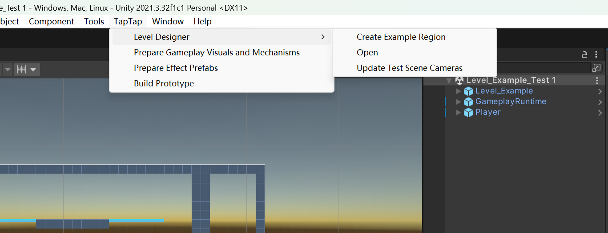
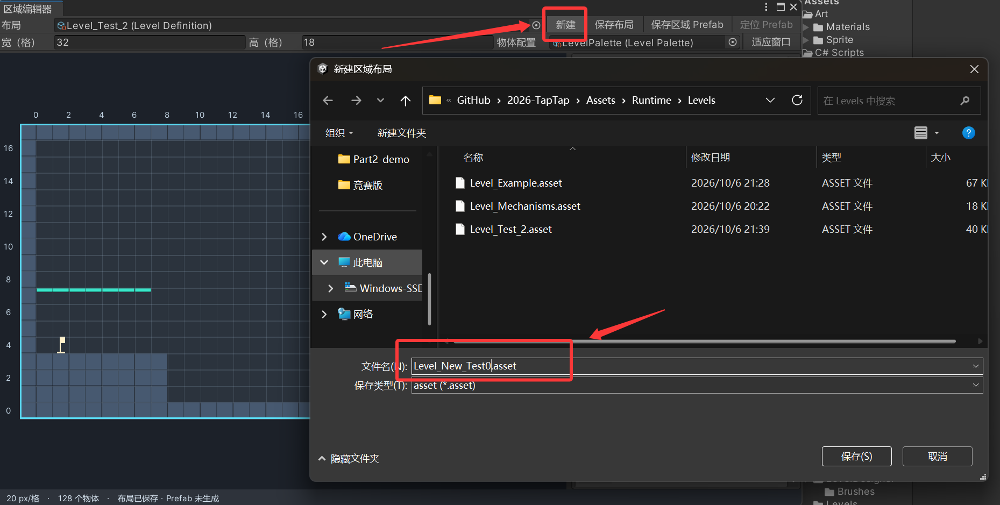
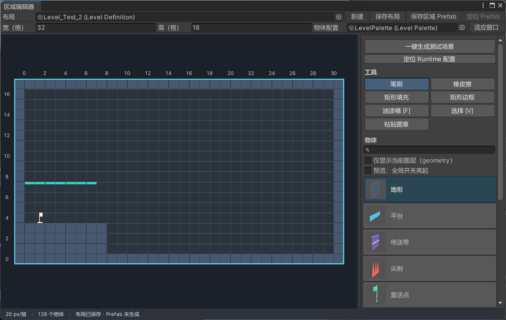
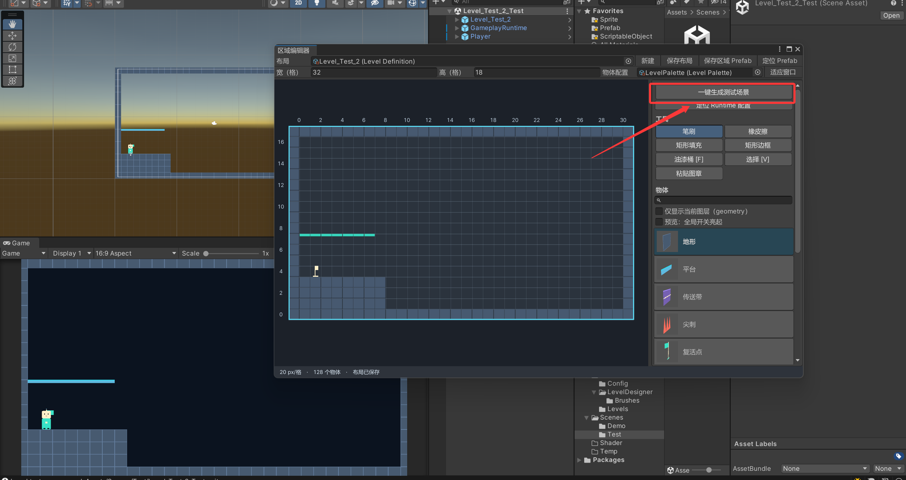
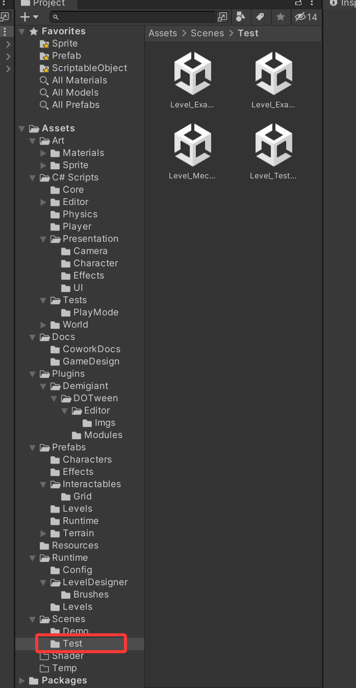

# 关卡编辑器

此编辑器用于快速搭建谜题验证功能，暂时不用于美术资源配置等工作（

快速探索一些谜题组合的难度和心流曲线，以及预览它们的地形结构，方便后续挑选放进大地图组合。

### 怎么用？

1. 在上方菜单点击 **TapTap → Level Designer** 打开关卡编辑器

2. 新建一个关卡配置，文件的保存位置预设好了，只需要给它命名即可

3. 在编辑器中直接设计关卡，左键涂鸦，右键橡皮，中键取色，其它功能和像素绘画软件差不多。

调整画布时，直接拖动画布外侧的蓝色边缘或箭头把手：向外拖动扩展，向内拖动回缩，四条边均支持。拖动时显示扩展或回缩的格数，松开确认，Esc 取消；每个方向最小保留 1 格，最大 2048 格。侧栏“画布边缘”提供四个扩展按钮，每次可选增加 1、4、8、16 格。调整只改变可编辑范围，原有图块、入口、批注和大世界中的位置保持不动，Ctrl+Z 可撤销，Ctrl+Y 可重做。回缩后越界的图块仍然保留，暂时隐藏并提示越界；重新扩展或撤销后恢复显示。越界图块需重新纳入画布或主动删除后才能保存 Prefab，回缩不会自动删除。向左或向下扩展后，新区域允许使用负坐标。上方宽高输入继续保留，增加宽度向右扩展，增加高度向上扩展。画布与按图块自动生成的实际关卡轮廓分别调整，调整画布不会改写手动边界。

4. 选择一键生成测试场景，会自动将需要配置的其它内容完成并创建该场景，Play即可直接测试效果

5. 保存的关卡预览位置

### 批量框选与移动

按 **V** 或选择“框选 / 移动”工具，按住左键拖动框选矩形区域。在选区内按住左键拖动，预览目标位置，松开后完成批量移动；也可以用方向键逐格微调。按 **Shift + 左键拖动** 可重新框选，拖动途中按 **Esc** 取消移动。

移动会用整个选区覆盖目标区域，选区中的空格也会清空对应目标格；原位置空出的部分留空。选区与目标重叠时也按这一规则处理。默认移动所有图层，开启“仅显示当前图层”时只移动和覆盖当前图层。选区不能移出地图边界；一次移动可用 **Ctrl+Z** 撤销。选中物体的配置、批注和入口标记随物体保留；若覆盖了未选中的入口复活点，需重新指定入口。

### 整张地图镜像

侧栏顶部“快速镜像”提供 **左右镜像** 和 **上下镜像**，以当前编辑画布的中线翻转整张地图。操作包含全部图层，即使开启“仅显示当前图层”也会一起镜像；图块、批注、入口、框选区域及已有手动边界一起换位，画布尺寸和大地图中的模块原点保持不动。尖刺朝向、左右传送带方向与复活点出生偏移会相应翻转，批注文字保持原文。大地图预览即时更新，Ctrl+Z 撤销，Ctrl+Y 重做。Prefab 中手动添加的 Custom 对象不属于网格内容，保持原样；更新测试场景需重新生成。

### 物体转向

按 **T** 或点击侧栏的“转向 [T]”按钮：在笔刷、矩形或油漆桶工具中转向当前笔刷；按 **V** 选择已放置的物体后，转向选中的物体。框选区域时，各个支持转向的物体会分别转向，格子位置不变；不支持的物体跳过。已放置物体的转向支持 Ctrl+Z 撤销。

- 尖刺每次顺时针转 90°：上 → 右 → 下 → 左。外观和致死碰撞体一起旋转，也可在“朝向”下拉框中直接选择。
- 传送带每次切换左右方向（箭头转 180°），同时反转速度正负；停止的传送带也能切换箭头方向。
- 机关按钮每次切换上下方向（转 180°），也可在“朝向”下拉框选择上或下。向上的按钮贴格子底边，向下的按钮贴格子顶边，外观与触发碰撞体一起翻转。上下镜像会同步反转按钮朝向，左右镜像保持上下朝向。

转向会显示在网格预览中，并保留在关卡资源、复制粘贴和生成的 Prefab／测试场景里。**R** 仍然是矩形工具。

### 测试批注与体验评价

使用“测试批注 [N]”笔刷放置批注，在关卡编辑器中将鼠标放到批注上按 N 编辑原文。批注原始内容保存在 `Assets/Runtime/Levels/*.asset` 中的 `Placements → AnnotationPlacementSettings.Text`；测试场景里的批注只是它的展示实例。

在 Unity 编辑器的 Play 模式测试场景时，角色身体或头部靠近红色批注标记，会出现批注内容和 E 键提示。按 E 打开 UGUI 评价窗口，只需给“感觉如何”选一个 1～5 分，补充说明可写可不写。多个批注范围重叠时打开距离角色最近的一个。

窗口打开期间暂停游戏，输入文字不会触发移动、头身分离或 R 键重置。点击分数立即保存，补充说明输入停顿半秒或失去焦点后自动保存，点击“继续玩”、按 Esc 或退出 Play 模式时也会保存。评价带时间追加到原始批注末尾，保留原文和此前的评价；同一次窗口内继续修改会更新当前记录。退出 Play 模式后可在关卡编辑器按 N 查看和编辑这些评价。

新生成的测试场景通过批注 ID 定位原始内容；旧测试场景自动通过所属关卡和批注的格子位置定位。若窗口提示找不到原始批注，请重新生成测试场景。回写功能用于 Unity 编辑器的 Play 模式，发布后的游戏不写入工程资源。

### 大地图模板与拼装

打开 **TapTap → World Map Designer**，会继续打开上次使用的布局。双击 `Assets/Runtime/WorldMaps/World_Character.asset` 可直接打开角色模板。也可点击“新建地图”，保存独立的拼装方案，再从侧栏选择“分体角色”或“爱心”模板。切换模板会采用该形状的默认尺寸，保留全部模块位置，可撤销。

大地图的一格对应单关的一格。侧栏可分别设置模板宽度和高度，或选择比例一致的小、中、大尺寸。外围留边只是画布上的灰色空间。调整模板尺寸或留边保留所有模块坐标，不会缩放关卡或自动挪动模块。

**分体角色模板**由上下等高的两个主体组成：顶底保持直线，四角圆角，中间相向的边缘略微外凸，上下之间留一条窄缝。轮廓采用之前确认的主体造型，不包含天线、手脚和表情。默认总尺寸为 320×448 格，小号为 160×224，大号为 640×896；总尺寸包含两侧外凸边缘和中缝。中缝默认占总高约 2.2%（默认尺寸留空 10 格），圆角半径默认占主体宽度的 5.5%，都可以在侧栏调整。中缝取完整格子，并保证上下等高，实际格数会显示在侧栏。中缝也属于灰色留空区；即使关卡四角分别落在上下两个主体里，整块关卡横跨中缝仍会提示越界。

**爱心模板**继续保留在 `Assets/Runtime/WorldMaps/World_Heart.asset`，已有布局的尺寸、模块引用和位置沿用原数据。爱心左右对称，以直边、斜边构成主体，在顶部心瓣和两侧肩部使用少量曲线连接。小、中、大尺寸分别为 160×144、320×288、640×576。

从模块库选择“放置”，再点击画布确定该关卡的原点（原始编辑画布的左下角）。也可以从 Project 拖入关卡布局 `.asset` 或带有来源布局的区域 Prefab。拖动模块内部可整体移动，方向键逐格微调，Shift+方向键移动 8 格；侧栏可精确输入原点坐标。滚轮以鼠标所在位置缩放，中键或 Alt+左键平移，按 F 查看全图。

**框选并整体移动**：在“拼装 [V]”模式下，从空白处按住左键拖出选框；按住 Shift 从任意位置拖动可重新框选。选框碰到实际关卡范围就选中整个模块，L/S 形关卡的空缺不会误选。多个模块会一起高亮，并显示整体选区；拖动任意所选模块或选区内空白，可以整组移动并保持相对位置。松开确认，Esc 取消，Ctrl+Z 撤销；方向键整体移动 1 格，Shift+方向键移动 8 格。Ctrl+D 和 Delete 对整组选中的模块执行复制和删除。多选时暂不显示单个关卡的边界调整把手，单选后可继续调整；通行箭头仍单独移动。“框选新关卡 [B]”继续用于创建等大的子关卡。

**双击模块直接打开该关卡的网格编辑器**，与侧栏“编辑单关”的行为一致。若要查看场景，点击侧栏“打开场景并定位关卡”。已生成的测试场景会按来源关卡自动匹配，也可在侧栏的“导航场景”指定场景；绑定使用 GUID，场景改名或移动后仍有效。没有对应场景时，首次场景导航会生成测试场景，之后重复打开该场景。导航到含有整体大地图 Prefab 的场景时，会优先按生成物体名称中的模块 ID 定位所点击的那一份关卡。切换场景前 Unity 会按常规提示处理未保存的场景。

拼图以**最外层图格形成的实际关卡轮廓**为单位，可呈 L、S 或其他不规则形状，并保留凹口和独立块。图格围住的空白内部也属于关卡范围；与外侧相通的凹口留空。测试批注不扩大范围，尚未放置任何地形的关卡暂用原始画布范围。越界、重叠、鼠标选中和 PNG 导出都按实际范围判断，因此可以在 L 形凹口拼入另一个模块。灰色区域应留空；模块越界时显示红色边框，并在灰区内染红越界格子。**两个关卡共享的每一格图块类型完全相同，就允许重叠**：同一格各图层使用相同图块笔刷，或双方都为空格，视为一致；不同图块、额外物体图层、空格与实块不一致时，显示橙色边框并提示冲突。测试批注不参与类型比较。允许暂时放在不合适的位置，方便调整，但生成整体 Prefab 前必须解决越界、重叠格块冲突、缺失来源和单位长度不一致等问题。粉色线是模板参考轮廓，格子中心位于轮廓内的格子属于可放置区域。

**选中模块后，拖动白色轮廓或方形把手可逐格调整那一段边界。** 拖动时预览，松开提交，Esc 或窗口失焦取消；Ctrl+Z 撤销。只修改关卡范围，不挪动、缩放或删除地形，向内拖动也会保留已有图块所在的格子。手动范围可以超过原始编辑画布，地形仍保持原始局部坐标；若要在扩展范围内绘制新地形，需在单关编辑器另行扩大画布。侧栏“恢复按图格自动生成边界”可恢复自动轮廓。边界保存在来源关卡里，同一来源的所有模块一起更新；关卡编辑器用绿色线显示实际轮廓，场景中的 LevelRegion Gizmo 也显示这一轮廓。相机按轮廓的外接矩形限制跟随范围；凹口、独立块之间的留空和地图外侧暂时正常显示，不加遮罩。

**关卡相机设置**：选中来源关卡布局 `.asset`，在 Inspector 的 `Camera Settings` 中默认启用 `Auto Size`：镜头 Size 取地图外接矩形长宽较大值的一半，上限 12 格；不超过 12 时固定居中，超过 12 时以 Size 12 平滑跟随。关闭 `Auto Size` 后可手动设置 `View Size`（镜头半高，默认 9 格）。还可配置 `Follow Horizontal` / `Follow Vertical`（横纵跟随开关）、`Offset`（相对身体表现位置的偏移）和 `Dead Zone`（缓冲区半宽、半高占整个画面的比例，默认中央 20% 宽、30% 高）。没有来源布局的区域可直接在 `LevelRegion` 中配置。玩家超出缓冲区才会带动镜头，普通小幅移动和跳跃保持画面稳定；宽高不足一屏的方向居中显示，长关卡仍可在另一方向跟随。设置跟随来源关卡保存，重新生成 Prefab 时保留；已有测试场景无需重新生成，运行时会按新设置跟随。启用跟随时，出生定位会立即对准玩家，回溯直接跟随当前历史位置；固定镜头始终保持地图居中。

关闭“显示内部地形”可专注查看关卡块的整体形状；开启时显示原始布局里的墙体、平台、机关和标记。当前预览按布局数据绘制，不包含区域 Prefab 的 `Custom` 下手工添加的美术。模块使用原始关卡引用；编辑单关会更新引用该关卡的所有模块。如需制作变体，先复制单关资源。

Ctrl+D 复制选中模块，Delete 删除，Ctrl+Z / Ctrl+Y 撤销和重做，Ctrl+S 保存大地图布局及引用关卡的边界修改。导出 PNG 可获得整张地图的像素预览，灰区和越界提示也会保留。未放模块时导出的是当前形状的纯模板。

“生成整体 Prefab”按网格坐标将全部模块放在同一个根物体下，默认保存到 `Assets/Prefabs/WorldMaps`。单关保持嵌套 Prefab 引用，单关和大地图的 `Custom` 内容在重新生成时保留。该按钮会根据当前布局更新所使用的单关 Prefab。将整体 Prefab 放入同一个场景即可查看空间拼装结果；添加配置好的 GameplayRuntime 和玩家后可运行关卡流程，也可以直接使用“生成入口与游玩”。模板灰区和粉色轮廓仅用于编辑和 PNG 预览，不会生成游戏碰撞体。

### 通行标记与框选新关卡

大地图侧栏顶部有三个设计工具：**拼装 [V]、通行 [P]、框选 [B]**。

选择“通行”，在画布上点击放置一个独立的黄色箭头。在侧栏用方向按钮或角度滑条调整朝向，可填写备注，并选择是否“双向通行”（显示双头箭头）。箭头直接放在需要指示穿行的位置。

点击已有箭头可选中，拖动或用方向键移动；侧栏可以精确改坐标、复制、删除。地图平时只显示箭头，选中后显示备注，悬停可查看备注。通行标记保存在大地图布局中，支持保存、撤销和重做；PNG 导出也使用独立箭头，完整文字备注保存在布局中。标记用于宏观通行设计，游戏里的实际跨关行为仍由运行时逻辑实现。

选择“框选”，在画布上按左键拖出矩形区域，快捷指定新关卡的画布大小和位置。区域包含起点和终点格，正向、反向拖动都可以；松开后，侧栏显示左下角坐标和宽高，可继续精确调整。**创建时不检查与已有关卡是否重叠**，可以直接在已有模块上框选。绿色表示可创建，红色提示范围进入模板灰区。

检查大小并选择物体配置后，点击**“确定创建子关卡并进入编辑器”**，输入新关卡名称。新建布局的画布宽高与框选范围完全相同，自动放到该范围左下角，并打开单关编辑器。创建的是普通关卡，不预设手动边界；开始绘制后，实际轮廓按最外层图格自动生成，编辑画布仍保持创建时的尺寸。选择已有资源名称时会生成新路径，保留原资源。Esc 取消框选；创建后 Ctrl+Z 可撤销地图中的放置，新关卡资源仍保留在模块库中。

单关编辑器里的绘制、擦除、移动和物体配置修改会主动刷新大地图地形和轮廓，**无需保存或切回大地图**；同一来源的所有模块同步更新。撤销、重做以及 Inspector 中的布局修改也会刷新预览。更新地形预览不改变模块在大地图中的原点坐标；已经手动设置的边界继续保留。

### 同场景完整游玩流程

在大地图中选中模块，设置“关卡序号”。程序按序号从小到大推进，序号可以不连续，但不能重复；旧地图的 0 沿用列表顺序。“按当前列表重新编号 1…N”可一次编号，新建或复制的模块自动使用末尾的新序号。序号属于大地图中的模块，同一个单关资源的不同摆放可使用不同序号。

每个单关需要指定入口复活点并放置终点。点击“生成入口与游玩”，批量更新所有单关 Prefab、外轮廓资产和整体 Prefab，并创建或更新 `Assets/Scenes/WorldMaps` 下的初始选关场景和同场景游玩场景。初始选关场景自动放到构建列表首位。单关及大地图 Prefab 的 `Custom` 内容保留；重新生成游玩场景会重建该生成场景中的内容。

已有单关 Prefab 时，可点击“生成选关入口”：保留现有整体游玩场景；尚未生成整体场景时，生成一个运行时拼装全部单关的游玩场景。这个入口允许唯一复活点作为出生入口，但仍要求所有关卡已生成 Prefab、具有终点、网格单位一致及序号唯一。

运行时只启用当前关卡，其他关卡的画面、碰撞和机关暂停。身体抵达终点后，转场显示所有已通过关卡的编号轮廓；刚完成的一块滑入大世界的原始位置，拼接后恢复地图初始对象及机关状态，玩家传送到下一关入口，重生点和镜头同步切换。转场禁止操作和回溯，并清空上一关的回溯历史。轮廓按实际格子边界自动生成，保留凹形和独立区域，使用 LineRenderer 加一层淡光。

PageDown 或 HUD 的“下一关”跳过当前关，也可输入序号跳到指定关。跳过的关卡不会计为已通过。R 或“重开本关”刷新本关并返回入口，保留已通过记录。最后一关完成后保留拼接进度画面，可返回第一关重玩或返回选关。弹簧默认弹起高度统一为 4.5 格。

初始选关场景复用转场的编号拼图，保持各模块在大世界中的拼接位置。点击某一块即可进入；也可用左右方向键选择，Enter 进入。薄荷色表示已通过，青色表示可进入，灰色表示未解锁。首次开放序号最小的一关，通关自动解锁下一关；**P 解锁全部关卡**，只开放进入权限，不增加通关记录。游戏中按 **Esc** 或点击 HUD 的“返回选关”回到入口；全部关卡之间的推进仍在同一个游玩场景中进行。通关和解锁记录按大世界资源 ID 保存在本机 PlayerPrefs，退出后仍保留；编辑器的跳关会开放被访问的关卡，但不会记录为已通过。
