# TapTap 机制组合场景创意

这些场景把现有机制当作可组合的输入输出，优先寻找规则交叉产生的新用途。每张卡都包含一个局部谜题与对照输入；观察目标可以成为后续完整关卡的一段。关卡布局是可编辑实验草图，尚未按完整通关路线封闭。

坐标以编辑器左下角为原点，单位为格。P表示全局虚实状态，B表示身体，H表示头；正相块在P=1时实，反相块在P=0时实。所有图画的是P=0初态。示意图的粗细与注释用于理解，不等同于碰撞体精确边缘。

## 场景索引

| 场景 | 组合 | 核心思考点 | 建议顺序 |
| --- | --- | --- | --- |
| S01 隔层遥控 | 伸头 × 单向平台 × 按钮 × 虚实 | 玩家是否把“能碰按钮的东西”错误等同于身体？ | 优先 |
| S02 换掉头脚下的地板 | 虚实 × 单向平台 × 分离 × 按钮 | 支撑和遮挡是否来自同一个对象？移除支撑有时反而改善可达性。 | 优先 |
| S03 把锚点运到另一边 | 传送带 × 分离 × 吸附 | 玩家搬运的是“未来可用的坐标”，不是一个可操控的第二角色。 | 优先 |
| S04 一颗头的两次脉冲 | 传送带 × 按钮 × 虚实 × 时序 | 速度不变时，按钮间有效时间约等于距离除以带速；传感器尺寸会修正边缘时刻。 | 优先 |
| S05 死亡是身体的回程 | 复活点 × 死亡 × 分离 × 虚实 | 死亡改变的是位置，重开改变的是世界状态。两者可以被设计成不同工具。 | 优先 |
| S06 只寄回头 | 传送带 × 头部死亡 × 复活点 × 拾取 | 死亡可以承担搬运；触碰旗帜的对象和接受返回的对象不必相同。 | 优先 |
| S07 同一颗头的三个答案 | 接触方向 × 踩头 × 拾取 × 合体空间 | 玩家要决定的是接触事件的方向，而不仅是头的位置。 | 优先 |
| S08 借头下楼 | 传送带 × 向下合体 × 单向平台 | 从上而下的合体有一个专门的通行输出，不只是变成完整角色。 | 后续 |
| S09 先下去才能跳得更高 | 远距离吸附 × 落差 × 单向平台 | 距离既是负担，也能是输入资源；“远”在这里改变动作种类。 | 优先 |
| S10 不要让按钮空出来 | 按钮 × 占用接力 × 头身双实体 × 虚实 | 两个物体的空间接力可以控制事件数量，不必新增机关。 | 优先 |
| S11 先矮一次再长高 | 分离 × 矮通道 × 拾取受阻 × 传送带 | 空间条件可以拒绝自动拾取，让玩家决定什么时候变高。 | 优先 |
| S12 隔壁房间仍在计时 | 视野外模拟 × 传送带 × 按钮 × 全局虚实 | 房间边界限制信息，却不必限制因果。谜题可以让玩家推断屏幕外发生了什么。 | 后续 |
| S13 把实化当作位移 | 虚实 × 实化挤出 × 位置选择 × 按钮 | 实化输入可以产生位置输出，但这是要验证的空间行为，适合做实验卡。 | 实验 |
| S14 带着知识重选同一刻 | 回溯 × 传送带 × 按钮 × 分支 | 回溯只保留玩家的知识，不保留有利的未来机关状态。 | 后续 |
| S15 让弹簧替身体按按钮 | 弹簧 × 传送带 × 分离头 × 按钮 × 虚实 | 弹簧把落下转换成上升，按钮把位移转换成全局状态；物体运动形成了事件源。 | 优先 |
| S16 低顶给头设定高度 | 伸头受阻 × 悬停 × 横移 × 按钮 | 环境可以给一次动作赋参数；玩家通过位置选择悬停高度。 | 优先 |

## S01 隔层遥控

**谜面：**身体留在下层，怎样让前面的实墙消失？

按钮放在上层单向平台上，门放在身体行进的下层。头不是只能用来移动身体，也可以成为伸到另一层的触发器。

**组合与起态：**伸头 × 单向平台 × 按钮 × 虚实。画布 24×14，入口旗帜 (2, 1)，P=0，出生为合体。机制可组合，布局待实测。

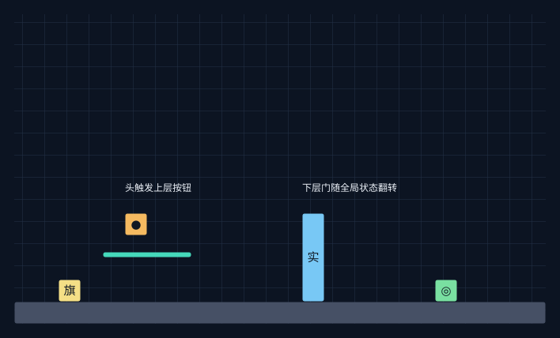

### 场景搭建

| 对象 | 左下角 | 宽高 | 配置 |
| --- | --- | --- | --- |
| Terrain | (0,0) | 24×1 | 笔刷默认 |
| Platform | (4,3) | 4×1 | 笔刷默认 |
| MechanismSwitch | (5,4) | 1×1 | 笔刷默认 |
| InversePhaseBlock | (13,1) | 1×4 | 笔刷默认 |
| Endpoint | (19,1) | 1×1 | 笔刷默认 |

### 一条探索路线

1. 从入口走到上层平台正下方。按住空格，头向上穿过单向平台。

2. 在收头经过上层按钮时触发一次翻转；头被平台接住而分离。身体沿下层穿过已经虚化的门。

3. 若要继续合体，需要另一次空格操作，并重新走到头的正下方；仅通过门可作为实验目标。

### 输入与输出

| 输入或对照尝试 | 状态变化 | 可观察输出 |
| --- | --- | --- |
| 站在下层直接走向门 | P=0，反相门为实 | 原路线被阻挡 |
| 伸头穿过平台，再收头经过按钮 | P:0→1，H留在平台上 | 远处门打开，B仍在下层 |
| 一直把头留在按钮区 | 占用继续为真 | 不产生连续翻转 |
| 再次吸附到头 | B向上，成功后普通跃起 | 遥控器变回移动锚点 |

### 思考点

- 玩家是否把“能碰按钮的东西”错误等同于身体？

- 一次动作同时改变人物形态和远处通路，但这两个输出可以独立利用。

### 可以继续变形的方向

- 把门换成亮时实的桥：同一次翻转从“移除障碍”变为“增加支撑”。

- 在下层加一格矮洞，让不急于回收头成为更有价值的选择。

### 验证重点

- 上层按钮必须与头的收头轨迹相交，不能只放在最大伸头终点之上。

- 门使用 SolidWhenActive=false，初始 P=0；头的支撑使用永久单向平台。

## S02 换掉头脚下的地板

**谜面：**头留在上层实块上，身体无法吸附穿过它。怎样把这个头变成可用的锚点？

支撑头的实块同时是吸附的天花板。把支撑虚化，头会落到更低的永久单向平台；同一个头因此从“被保护但不可达”变成“可吸附”。

**组合与起态：**虚实 × 单向平台 × 分离 × 按钮。画布 24×14，入口旗帜 (2, 1)，P=0，出生为合体。机制可组合，布局待实测。

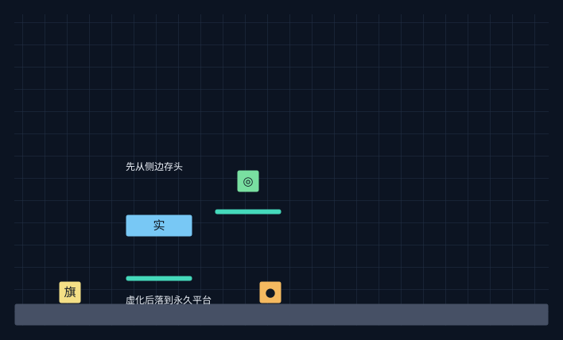

### 场景搭建

| 对象 | 左下角 | 宽高 | 配置 |
| --- | --- | --- | --- |
| Terrain | (0,0) | 24×1 | 笔刷默认 |
| InversePhaseBlock | (5,4) | 3×1 | 笔刷默认 |
| Platform | (5,2) | 3×1 | 笔刷默认 |
| MechanismSwitch | (11,1) | 1×1 | 笔刷默认 |
| Platform | (9,5) | 3×1 | 笔刷默认 |
| Endpoint | (10,6) | 1×1 | 笔刷默认 |

### 一条探索路线

1. 在高台侧边伸头到最高，再保持空格横移，让头跨到实块上方，松开把头留住。

2. 身体到地面按钮处翻转，反相实块消失，头落到下方单向平台。

3. 回到头下方再吸附，观察路径从实体阻挡变为向上可穿过。

### 输入与输出

| 输入或对照尝试 | 状态变化 | 可观察输出 |
| --- | --- | --- |
| 头在反相实块上时尝试吸附 | 吸附开始后撞到实块底面 | 保持分离；蓝色引导不保证路径通畅 |
| 身体进入按钮 | P:0→1，反相支撑消失 | H下落到永久单向平台 |
| 头落稳后再次吸附 | 上升穿过单向平台 | 成功合体并跃起 |
| 过早再次翻转 | 支撑重新实化 | 可能改变落点，需重做时序 |

### 思考点

- 支撑和遮挡是否来自同一个对象？移除支撑有时反而改善可达性。

- 引导线判断的是对齐与上下关系，碰撞发生在真正吸附的过程中。

### 可以继续变形的方向

- 在落头路径放按钮，让第一次翻转引发第二次事件；永久捕获台要保留。

- 把捕获台错开半个角色宽度，增加落点与对齐的选择。

### 验证重点

- 实体高台不能让头直接从下方穿过；草图需要从侧边伸头再横移。

- 按钮远离落头点，避免头无意重复占用改变设计的翻转次数。

## S03 把锚点运到另一边

**谜面：**头已经留在传送带上。身体应该追它，还是等它进入一条有用的竖直通道？

传送带改变头的水平位置，从而改变可吸附位置。头可以被送到身体本来无法把头伸上去的位置。开始吸附后目标取当时位置，吸附阶段头不再自由模拟。

**组合与起态：**传送带 × 分离 × 吸附。画布 24×14，入口旗帜 (2, 1)，P=0，出生为合体。机制可组合，布局待实测。

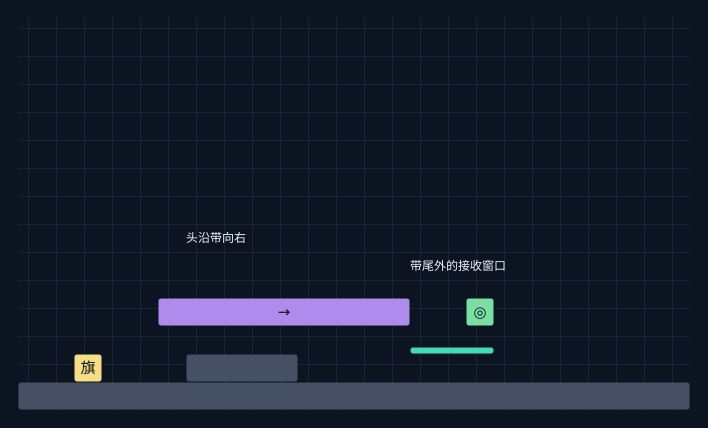

### 场景搭建

| 对象 | 左下角 | 宽高 | 配置 |
| --- | --- | --- | --- |
| Terrain | (0,0) | 24×1 | 笔刷默认 |
| Conveyor | (5,3) | 9×1 | {"Speed": 1.25} |
| Terrain | (6,1) | 4×1 | 笔刷默认 |
| Platform | (14,2) | 3×1 | 笔刷默认 |
| Endpoint | (16,3) | 1×1 | 笔刷默认 |

### 一条探索路线

1. 在传送带左侧伸头，再保持空格横移到传送带上方，松开。

2. 头向右运输，身体在下层移动到接收窗口正下方。

3. 等水平误差进入0.35格以内，按下并松开空格，在接收窗口吸附。

### 输入与输出

| 输入或对照尝试 | 状态变化 | 可观察输出 |
| --- | --- | --- |
| 头运输时原地提前松空格 | |Bx−Hx|>0.35 | 吸附失败，头继续运输 |
| 在窗口对齐后松空格 | 记录当时的头位置为吸附目标 | B上升，H在本次吸附中停住 |
| 在传送带实体下方吸附 | 对齐成立但路径有实体带面 | 吸附受阻；必须在带尾窗口或另设单向带面 |
| 头滑出带尾后再等待 | H自由下落 | 窗口随时间变化，可能改为接落头 |

### 思考点

- 玩家搬运的是“未来可用的坐标”，不是一个可操控的第二角色。

- 启动吸附也是一种停止头部运输的方法。

### 可以继续变形的方向

- 左右两条带提供两个接收窗口，比较“选位置”与“选时机”。

- 让窗口下方有实天花板和空井两个选择，验证对齐与可达不是一回事。

### 验证重点

- 现有传送带笔刷是实体；不能默认身体能穿过带面。有效吸附窗口应位于带尾外侧。

- 吸附目标在 BeginPull 时固定，不能把此草图理解为身体追逐持续移动的头。

## S04 一颗头的两次脉冲

**谜面：**门只在头经过第一个按钮和第二个按钮之间打开。怎样利用这段时间？

同一颗头依次进入两个独立按钮，令 P 按0→1→0变化。传送距离成为延迟，按钮间距成为通路保持时间。

**组合与起态：**传送带 × 按钮 × 虚实 × 时序。画布 26×14，入口旗帜 (2, 1)，P=0，出生为合体。机制可组合，布局待实测。

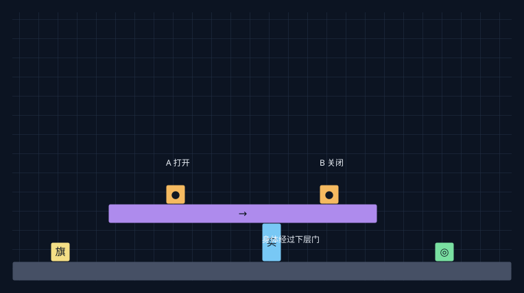

### 场景搭建

| 对象 | 左下角 | 宽高 | 配置 |
| --- | --- | --- | --- |
| Terrain | (0,0) | 26×1 | 笔刷默认 |
| Conveyor | (5,3) | 14×1 | {"Speed": 1.25} |
| MechanismSwitch | (8,4) | 1×1 | 笔刷默认 |
| MechanismSwitch | (16,4) | 1×1 | 笔刷默认 |
| InversePhaseBlock | (13,1) | 1×2 | 笔刷默认 |
| Endpoint | (22,1) | 1×1 | 笔刷默认 |

### 一条探索路线

1. 把头留在高处向右的传送带上，让它依次经过A、B按钮。

2. 身体在下层门前等待A触发，然后进入门后的安全区。

3. B触发后门重新实化；谜题目标可以是安全区，而无需完整终点。

### 输入与输出

| 输入或对照尝试 | 状态变化 | 可观察输出 |
| --- | --- | --- |
| 头进入A，B尚未占用 | P:0→1 | 反相门虚化 |
| 头一直压着A | A.occupied=true | A不会再次翻转 |
| 头离开A并进入B | P:1→0 | 门重新实化 |
| 身体也误碰另一按钮 | 增加一次翻转 | 时间窗与原计划不同 |

### 思考点

- 速度不变时，按钮间有效时间约等于距离除以带速；传感器尺寸会修正边缘时刻。

- 机关的结果由进入事件数量的奇偶决定，不由按钮数或亮着的按钮数决定。

### 可以继续变形的方向

- 反向传送带交换按钮顺序，门不变而身体的可用出发点改变。

- 在B前设置安全回收窗口，让主动吸附头成为取消第二次脉冲的方式。

### 验证重点

- A、B传感区要间隔足够远，防止同一步触发两次而没有可感知窗口。

- 门后留至少两格安全空间，避免关闭时把玩家留在实化块内。

## S05 死亡是身体的回程

**谜面：**单向落下去以后无法走回头下方。有什么动作只搬回身体，却保留已经完成的准备？

把头留在安全平台，把身体送到远端按钮，再让身体碰尖刺。分体死亡只返回身体，头的位置和全局虚实状态继续保留。

**组合与起态：**复活点 × 死亡 × 分离 × 虚实。画布 24×14，入口旗帜 (2, 1)，P=0，出生为合体。机制可组合，布局待实测。

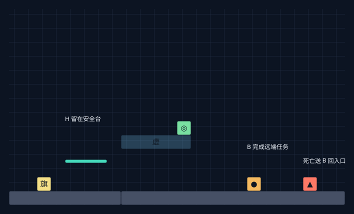

### 场景搭建

| 对象 | 左下角 | 宽高 | 配置 |
| --- | --- | --- | --- |
| Terrain | (0,0) | 8×1 | 笔刷默认 |
| Terrain | (8,0) | 16×1 | 笔刷默认 |
| Platform | (4,3) | 3×1 | 笔刷默认 |
| MechanismSwitch | (17,1) | 1×1 | 笔刷默认 |
| Spikes | (21,1) | 1×1 | 笔刷默认 |
| PhaseBlock | (8,4) | 5×1 | 笔刷默认 |
| Endpoint | (12,5) | 1×1 | 笔刷默认 |

### 一条探索路线

1. 在入口附近的单向台留下头。身体沿右侧落差去按钮区。

2. 触发按钮后从旁边尖刺死亡，回到入口旗帜。

3. 对齐安全平台上的头吸附，利用已经切换的路线继续前进。

### 输入与输出

| 输入或对照尝试 | 状态变化 | 可观察输出 |
| --- | --- | --- |
| 分离身体触发按钮后死亡 | B→旗帜；H位置保留；P保留 | 身体回程，准备工作不丢失 |
| 尚在磁力连接形态就死亡 | 头身一起返回 | 没有留下远端锚点 |
| 按R重新开始 | 场景重新加载 | 头位置和P都恢复初始 |
| 按Z回到触发按钮之前 | 整段历史恢复 | P也撤回，不是保留准备的回程 |

### 思考点

- 死亡改变的是位置，重开改变的是世界状态。两者可以被设计成不同工具。

- 牺牲可操作部分，保留不可操作部分，让身体与头承担不同时间尺度的任务。

### 可以继续变形的方向

- 把远端按钮换为新旗帜，观察身体返回目的地也随任务改变。

- 把头存放在危险传送带上，加入“回程时间里头仍在动”的限制。

### 验证重点

- 必须已经进入 Detached，伸头悬停仍属于连接状态。

- 安全头台不放尖刺，旗帜返回点下方保留地板；此草图强调返回操作，落差可再加大。

## S06 只寄回头

**谜面：**身体已经穿过矮通道，头还在另一边。能否借死亡把头送到身体预先指定的地址？

身体先刷新接收区旗帜，头再由传送带送入尖刺。分离头部独立返回当前复活点，身体继续留在原地。复活点是由身体设置的头部收件地址。

**组合与起态：**传送带 × 头部死亡 × 复活点 × 拾取。画布 26×14，入口旗帜 (2, 1)，P=0，出生为合体。机制可组合，布局待实测。

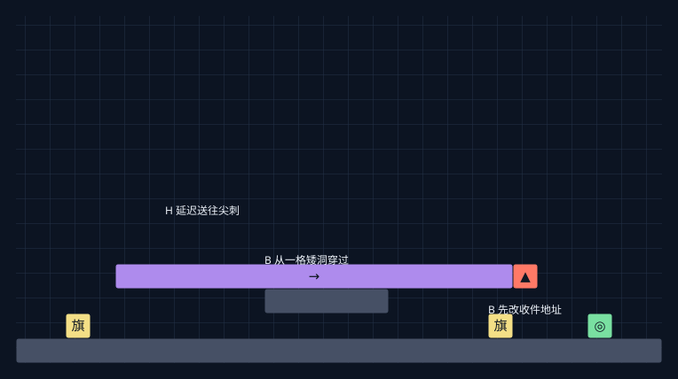

### 场景搭建

| 对象 | 左下角 | 宽高 | 配置 |
| --- | --- | --- | --- |
| Terrain | (0,0) | 26×1 | 笔刷默认 |
| Conveyor | (4,3) | 16×1 | {"Speed": 1.25} |
| Spikes | (20,3) | 1×1 | 笔刷默认 |
| Terrain | (10,2) | 5×1 | 笔刷默认 |
| Checkpoint | (19,1) | 1×1 | 笔刷默认 |
| Endpoint | (23,1) | 1×1 | 笔刷默认 |

### 一条探索路线

1. 在左侧高处传送带留下头，身体穿过右侧矮洞。

2. 身体触碰接收旗帜B，随后离开旗帜至少一格，给头的返回留空间。

3. 头到带尾尖刺后返回旗帜B。身体从侧面接近头，在宽敞处拾取。

### 输入与输出

| 输入或对照尝试 | 状态变化 | 可观察输出 |
| --- | --- | --- |
| 只有头路过新旗帜 | 复活点不更新 | 地址仍由上次身体接触决定 |
| 身体触碰旗帜B后头死亡 | H→B；身体保持当前位置 | 头跨越原先无法通过的路径 |
| 头死亡已开始后才改旗帜 | 旅程目的地已在 Begin 中记录 | 本次头仍飞往旧地址 |
| 身体从侧面接回到的头 | PickingUp→Joined，无额外跃起 | 可把头取回但不能借此跳高 |

### 思考点

- 死亡可以承担搬运；触碰旗帜的对象和接受返回的对象不必相同。

- “先设地址，后发货”形成顺序知识锁。

### 可以继续变形的方向

- 接收旗帜放在高处，身体离开后头独立占据高处锚点。

- 把旧旗帜也保留在通道出口，构成可选择的两种寄送结果。

### 验证重点

- 只有身体更新 CheckpointFlag；必须在头开始死亡返回之前更新。

- 接收旗帜周围不要压住身体、实体天花板或尖刺，避免返回后再立即死亡。

## S07 同一颗头的三个答案

**谜面：**目标在高处。面对地上的头，从侧面走过去和从上方落下，为什么结果不同？

头是同一个物体，接触方向却选择不同操作。身体侧面接触会拾取；身体从上方接触会弹起；头从上方落到身体会向下合体。

**组合与起态：**接触方向 × 踩头 × 拾取 × 合体空间。画布 24×14，入口旗帜 (2, 4)，P=0，出生为合体。机制可组合，布局待实测。

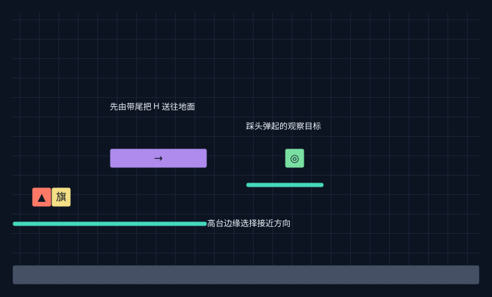

### 场景搭建

| 对象 | 左下角 | 宽高 | 配置 |
| --- | --- | --- | --- |
| Terrain | (0,0) | 24×1 | 笔刷默认 |
| Platform | (0,3) | 10×1 | 笔刷默认 |
| Conveyor | (5,6) | 5×1 | {"Speed": 1.25} |
| Spikes | (1,4) | 1×1 | 笔刷默认 |
| Platform | (12,5) | 4×1 | 笔刷默认 |
| Endpoint | (14,6) | 1×1 | 笔刷默认 |

### 一条探索路线

1. 从高台出生，在带面左侧伸头，再横移并松开把头留在传送带；头会从带尾落到高台外侧的地面。

2. 身体触碰高台尖刺回入口，保留远处头。等待头落稳，走下台从侧面取头，再回溯到下台之前。

3. 再从高台边缘落到头上，利用4.5格踩头弹起到观察目标平台；保持分离也可以算成功。

### 输入与输出

| 输入或对照尝试 | 状态变化 | 可观察输出 |
| --- | --- | --- |
| B 从侧面接触H | 平滑拾取，无附加向上速度 | 身体变高，但未获得高度 |
| B 从上方落到H | B获得踩头弹起速度，H留下 | B获得高度，但没有回收头 |
| H 从上方落到B | 向下合体，并忽略单向平台0.3秒 | 穿下平台，而非踩头弹跳 |
| 在矮顶下从侧面取头 | 拾取路径或合体形状被挡 | 仍分离，不能强行长高 |

### 思考点

- 玩家要决定的是接触事件的方向，而不仅是头的位置。

- 获得高度、获得完整身体和向下通行是三个可以互相竞争的目标。

### 可以继续变形的方向

- 高处目标改成只有身体高度能穿过的洞，使“弹起后别收头”成为关键。

- 头放在传送带上，等待它落下与主动踩上去形成相反动作。

### 验证重点

- 踩头要从上方落下；水平接触不会产生弹跳。

- 本场景的4.5格来自实际配置，不是文档里旧的3格；精确目标高度按碰撞边缘调整。

## S08 借头下楼

**谜面：**身体站在一块很宽的单向平台中间，无法从边缘绕下去。怎样进入下层？

让头从高处带尾落到身体上，触发向下合体。单向平台临时忽略是这一合体事件的输出，可以当成向下通路。

**组合与起态：**传送带 × 向下合体 × 单向平台。画布 24×14，入口旗帜 (2, 1)，P=0，出生为合体。落头机制成立，前置起态待打磨。

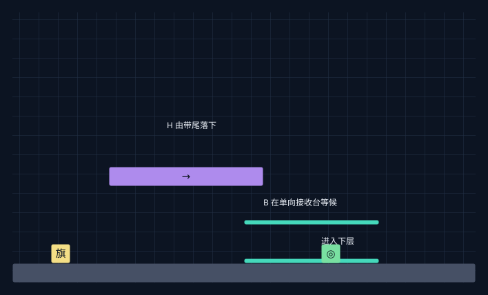

### 场景搭建

| 对象 | 左下角 | 宽高 | 配置 |
| --- | --- | --- | --- |
| Terrain | (0,0) | 24×1 | 笔刷默认 |
| Conveyor | (5,5) | 8×1 | {"Speed": 1.25} |
| Platform | (12,3) | 7×1 | 笔刷默认 |
| Platform | (12,1) | 7×1 | 笔刷默认 |
| Endpoint | (16,1) | 1×1 | 笔刷默认 |

### 一条探索路线

1. 先在右侧接收台留下头，再吸附并借普通合体跃起站上这块单向台。

2. 在带尾外侧伸头，保持空格横移到带尾上方，松开，把头留在更高的带面；身体仍在接收台上。

3. 身体移到带尾正下方等头从上落下，合体后穿过当前单向平台，到下方实体底板。

### 输入与输出

| 输入或对照尝试 | 状态变化 | 可观察输出 |
| --- | --- | --- |
| H 落到平台上的B | 向下速度至少4格/秒；忽略单向平台0.3秒 | 头身一同掉入下层 |
| B 落到静止H | 踩头弹起 | 往上，无法下楼 |
| 接收台替换为实体地面 | 实体碰撞继续生效 | 向下合体不能穿墙 |
| 下方再叠一层很近的单向平台 | 仍处于忽略窗口时不碰撞 | 可能穿过多层，不保证只下一层 |

### 思考点

- 从上而下的合体有一个专门的通行输出，不只是变成完整角色。

- 平台堆叠可以把时间窗口转译成楼层选择。

### 可以继续变形的方向

- 调整第二层平台间距，让玩家比较一次穿一层与一次穿多层。

- 让下层也是按钮，落下合体同时完成一次远处虚实翻转。

### 验证重点

- 稳定建立核心起态需要实测前置路线与带尾站位；不能默认场景出生即分离。

- 0.3秒不是“下一层”规则。返回目标下面加实体底板，先让结果可控。

## S09 先下去才能跳得更高

**谜面：**头已在高处。为什么在较近的位置吸附够不到目标，先往下走反而可以？

远距离吸附在触发时判断头身纵向位置差是否严格大于7格，选择3.4格合体跃起；近距离只选择1.1格。玩家可以先扩大距离，换取不同输出。

**组合与起态：**远距离吸附 × 落差 × 单向平台。画布 24×17，入口旗帜 (2, 7)，P=0，出生为合体。机制可组合，布局待实测。

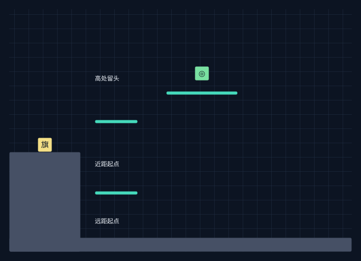

### 场景搭建

| 对象 | 左下角 | 宽高 | 配置 |
| --- | --- | --- | --- |
| Terrain | (0,0) | 24×1 | 笔刷默认 |
| Terrain | (0,0) | 5×7 | 笔刷默认 |
| Platform | (6,9) | 3×1 | 笔刷默认 |
| Platform | (6,4) | 3×1 | 笔刷默认 |
| Platform | (11,11) | 5×1 | 笔刷默认 |
| Endpoint | (13,12) | 1×1 | 笔刷默认 |

### 一条探索路线

1. 从左侧高地出生，把头留在邻近上层单向台。

2. 先走到中层平台对齐并吸附，观察普通跃起的最高点。

3. 回溯到吸附之前，走出中层平台落到下层，使头身差超过7格，再从同一竖井吸附。

### 输入与输出

| 输入或对照尝试 | 状态变化 | 可观察输出 |
| --- | --- | --- |
| 在头身纵向差小于等于7格时启动 | 选择 NormalLaunchHeight=1.1 | 普通合体跃起 |
| 差大于7格时启动 | 选择 DistantLaunchHeight=3.4 | 成功合体后跃起更高 |
| 启动后才改变路径或位置差 | 跃起类型已选定 | 不重新判定距离奖励 |
| 更远，但竖井被实体遮挡 | 吸附碰撞中止 | 距离不能弥补路径不通 |

### 思考点

- 距离既是负担，也能是输入资源；“远”在这里改变动作种类。

- 阈值在开始时采样，可以设计两个看似等价的起点。

### 可以继续变形的方向

- 把目标放在普通跃起与远距跃起最高点之间，形成明显二选一。

- 把地面按钮放在下层，让扩大距离同时切换目标平台的虚实。

### 验证重点

- 阈值比较的是头身位置基准的Y差，不是头脚距离或平台高度差；应留至少0.5格余量。

- 远距3.4格替代普通1.1格，不是额外叠加3.4格。出生点必须在高台，不能指望地面伸头达到9格。

## S10 不要让按钮空出来

**谜面：**第一次碰按钮后门打开。怎样把头取走，又不让身体的经过把门重新关上？

按钮占用是所有实体接触的合并结果。头离开之前身体已接触，整个占用区间就没有新的进入边沿；如果中间空了一步，身体重新接触会再翻转。

**组合与起态：**按钮 × 占用接力 × 头身双实体 × 虚实。画布 24×14，入口旗帜 (2, 1)，P=0，出生为合体。接力机制成立，按钮区宽度待调。

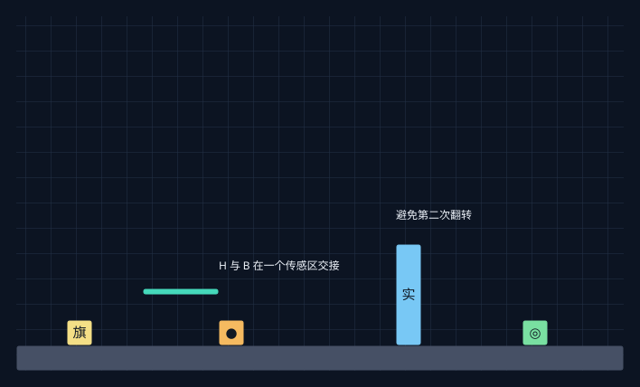

### 场景搭建

| 对象 | 左下角 | 宽高 | 配置 |
| --- | --- | --- | --- |
| Terrain | (0,0) | 24×1 | 笔刷默认 |
| Platform | (5,3) | 3×1 | 笔刷默认 |
| MechanismSwitch | (8,1) | 1×1 | 笔刷默认 |
| InversePhaseBlock | (15,1) | 1×4 | 笔刷默认 |
| Endpoint | (20,1) | 1×1 | 笔刷默认 |

### 一条探索路线

1. 先在按钮旁的上层单向平台留下头，利用平台边缘让头落入地面按钮区。

2. 身体在头仍占用按钮时从侧面接近，身体先进入按钮，再开始拾取头。

3. 让头随身体离开；观察门保持P=1。如果间隔进场，则门会回到P=0。

### 输入与输出

| 输入或对照尝试 | 状态变化 | 可观察输出 |
| --- | --- | --- |
| H先进入按钮 | occupied:false→true，P:0→1 | 门第一次打开 |
| H还在区内，B也进入 | occupied维持true | 不产生第二次翻转 |
| B占用期间把H取走 | 仍至少有一个实体接触 | P保持1 |
| H离开后区内空一步，B晚些进入 | false→true且冷却已过 | P:1→0，门关闭 |

### 思考点

- 两个物体的空间接力可以控制事件数量，不必新增机关。

- 这里要求连续占用；按钮并不是“压住则开，松开则关”。

### 可以继续变形的方向

- 把按钮加宽，降低接力精度，先突出规则理解。

- 在一个实体仍占用时让另一个来回经过，验证没有新增进入事件。

### 验证重点

- 区间需覆盖身体先进入、头再离开；当前按钮碰撞区可能需要在TEMP Prefab的Custom中调宽。

- 对照分支要等待超过0.18秒冷却，防止空档虽发生却未翻转。

## S11 先矮一次再长高

**谜面：**身体能过矮洞，完整角色不能。怎样让头也来到出口，并选择正确地点重新合体？

分离改变通行尺寸；传送带提供平行的头部路径；侧面拾取还会检查飞行路径与完整合体空间，因此“遇到头”与“可以取头”并不等价。

**组合与起态：**分离 × 矮通道 × 拾取受阻 × 传送带。画布 26×14，入口旗帜 (2, 1)，P=0，出生为合体。机制可组合，布局待实测。

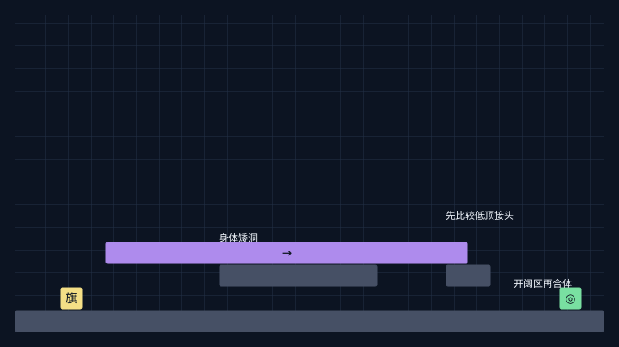

### 场景搭建

| 对象 | 左下角 | 宽高 | 配置 |
| --- | --- | --- | --- |
| Terrain | (0,0) | 26×1 | 笔刷默认 |
| Conveyor | (4,3) | 16×1 | {"Speed": 1.25} |
| Terrain | (9,2) | 7×1 | 笔刷默认 |
| Terrain | (19,2) | 2×1 | 笔刷默认 |
| Endpoint | (24,1) | 1×1 | 笔刷默认 |

### 一条探索路线

1. 在高处带面留下头，身体从带下的一格通道通过。

2. 在低顶出口提前碰头，观察拾取开始后被阻挡而继续分离。

3. 等头运到更外侧开阔区，身体在那里横向接近，安全拾取。

### 输入与输出

| 输入或对照尝试 | 状态变化 | 可观察输出 |
| --- | --- | --- |
| Joined走进一格高实体洞 | 完整碰撞形状高约1.5格 | 无法进入 |
| Detached身体进入同一洞 | 身体碰撞高0.9格 | 能通行，需皮肤余量 |
| 矮顶下从侧面接触头 | 合体空间或移动路径受阻 | 拾取失败，仍分离 |
| 开阔区侧面接触头 | 路径可通，形状可容纳 | 平滑合体，无额外弹起 |

### 思考点

- 空间条件可以拒绝自动拾取，让玩家决定什么时候变高。

- 头和身体走不同路线，最终在一个满足体积条件的位置会合。

### 可以继续变形的方向

- 把开阔区替换为上层单向平台，比较侧取与吸附的后续高度。

- 把矮顶做成虚实块：先运头，再打开合体空间。

### 验证重点

- 此配置身体高0.9、头高0.6、JoinedOffset=0.75，合体包围高度约1.5格；美术外观不能代替碰撞尺寸。

- 运输落点要能与身体同高侧碰，带尾高度及低顶长度需实测调整。

## S12 隔壁房间仍在计时

**谜面：**头留在左侧，身体进入右侧后没有再碰按钮。右边的桥为什么还会改变？

同一Unity场景中的头即使离开镜头也继续模拟，按钮仍翻转同一个全局P。可以让左侧运输过程延迟改变右侧的局部通路。

**组合与起态：**视野外模拟 × 传送带 × 按钮 × 全局虚实。画布 42×14，入口旗帜 (2, 1)，P=0，出生为合体。同场景机制成立，分房镜头待编排。

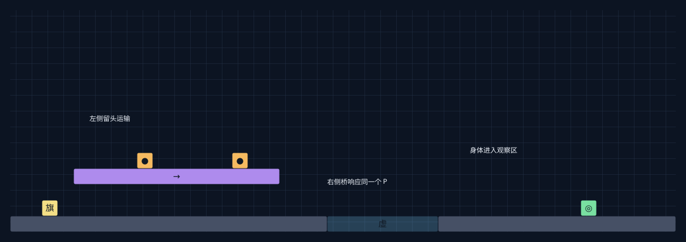

### 场景搭建

| 对象 | 左下角 | 宽高 | 配置 |
| --- | --- | --- | --- |
| Terrain | (0,0) | 20×1 | 笔刷默认 |
| Terrain | (27,0) | 15×1 | 笔刷默认 |
| Conveyor | (4,3) | 13×1 | {"Speed": 1.25} |
| MechanismSwitch | (8,4) | 1×1 | 笔刷默认 |
| MechanismSwitch | (14,4) | 1×1 | 笔刷默认 |
| PhaseBlock | (20,0) | 7×1 | 笔刷默认 |
| Endpoint | (36,1) | 1×1 | 笔刷默认 |

### 一条探索路线

1. 左侧传送带存头，身体通过下层通道进入右侧。

2. 头在左侧先后经过两个按钮，使右侧桥在一个时窗内实化。

3. 身体在右侧观察桥，决定等待第一次脉冲再过桥，或提前停止头的运输。

### 输入与输出

| 输入或对照尝试 | 状态变化 | 可观察输出 |
| --- | --- | --- |
| B离开左侧区域，H留在活跃对象中 | H继续重力和传送带模拟 | 没有因不入镜而暂停 |
| H在左侧进入A按钮 | 全局P:0→1 | 右侧亮时实桥出现 |
| H随后进入B按钮 | 全局P:1→0 | 右侧桥消失 |
| 实际重新加载另一Unity场景 | 原世界被替换 | 不能沿用本组合的持续模拟 |

### 思考点

- 房间边界限制信息，却不必限制因果。谜题可以让玩家推断屏幕外发生了什么。

- 远程延迟输出可以复用同一按钮和同一传送带，不需要电线系统。

### 可以继续变形的方向

- 先用一张全景地图教学，再在最终地图遮住左房间，只保留灯光线索。

- 两房间分别使用正相与反相支撑，远程输入同时帮助一边、妨碍另一边。

### 验证重点

- 当前 DemoCamera 的 fixedRegion 不会自动随身体切换区域；本草图是同场景远程实验，分房镜头需要在TEMP里另行编排或手动设置。

- WorldMapPassage只是编辑用箭头，没有自动传送逻辑；不可写成穿门换场景。

## S13 把实化当作位移

**谜面：**身体站在虚块里面。让它实化以后，会被挤到哪一边？能否预先用站位选方向？

实化不是单纯打开碰撞：WorldPhaseState会尝试把重叠实体沿上下左右的候选方向移出，按位移长度排序，要求目的地与扫掠路径可通。

**组合与起态：**虚实 × 实化挤出 × 位置选择 × 按钮。画布 24×14，入口旗帜 (2, 1)，P=0，出生为合体。实现存在，挤出方向和可解性待验证。

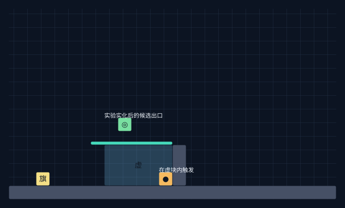

### 场景搭建

| 对象 | 左下角 | 宽高 | 配置 |
| --- | --- | --- | --- |
| Terrain | (0,0) | 24×1 | 笔刷默认 |
| PhaseBlock | (7,1) | 5×3 | 笔刷默认 |
| MechanismSwitch | (11,1) | 1×1 | 笔刷默认 |
| Terrain | (12,1) | 1×3 | 笔刷默认 |
| Platform | (6,4) | 6×1 | 笔刷默认 |
| Endpoint | (8,5) | 1×1 | 笔刷默认 |

### 一条探索路线

1. 从左侧进入尚为虚的块区，把身体靠近上边或侧边；按钮放在区内右侧。

2. 身体接触按钮，虚块实化，记录最终位移。

3. 回溯到进入按钮前，改变位置或用另一种墙体边界重复实验。

### 输入与输出

| 输入或对照尝试 | 状态变化 | 可观察输出 |
| --- | --- | --- |
| 重叠虚块时触发 P:0→1 | 按最短候选位移尝试挤出 | 可能得到无跳跃输入的位移 |
| 离不同外侧边界更近 | 候选长度排序改变 | 可能改变挤出方向 |
| 最短方向外侧被普通墙挡住 | ClearDestination拒绝该方向 | 尝试其他方向 |
| 所有候选方向被挡住 | 没有可用候选 | 代码不保证挤出，可能留在重叠处 |

### 思考点

- 实化输入可以产生位置输出，但这是要验证的空间行为，适合做实验卡。

- 多个相连实块会扩展占据范围，设计时要按整个连通块的外缘思考。

### 可以继续变形的方向

- 以左右两个安全落点做选择实验，先保持高度相同。

- 同样的空间分别放身体、分离头、合体角色，比较包围体差异。

### 验证重点

- 不要依赖等距离时稳定选择某个方向；Array.Sort的同值次序不是玩法保证。

- 本卡不把挤出穿普通墙当作可靠机制，正式关卡前先排除无候选和生成重叠。

## S14 带着知识重选同一刻

**谜面：**试过一次才知道门什么时候打开。怎样回到头出发的那一刻，换一条身体路线？

回溯恢复头、身体、P、按钮占用冷却和复活点，并在松Z后丢弃原来的未来。玩家保留认知，世界恢复同一初态；可以围绕这个信息差设计预测与执行的分支。

**组合与起态：**回溯 × 传送带 × 按钮 × 分支。画布 28×14，入口旗帜 (2, 1)，P=0，出生为合体。回溯机制成立，分支路线待打磨。

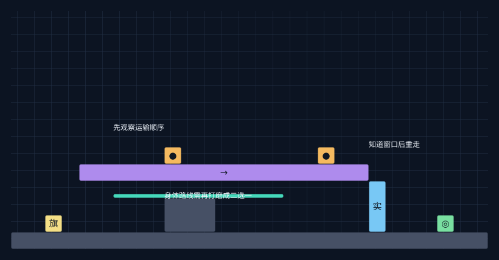

### 场景搭建

| 对象 | 左下角 | 宽高 | 配置 |
| --- | --- | --- | --- |
| Terrain | (0,0) | 28×1 | 笔刷默认 |
| Conveyor | (4,4) | 17×1 | {"Speed": 1.25} |
| MechanismSwitch | (9,5) | 1×1 | 笔刷默认 |
| MechanismSwitch | (18,5) | 1×1 | 笔刷默认 |
| Terrain | (9,1) | 3×2 | 笔刷默认 |
| Platform | (6,3) | 10×1 | 笔刷默认 |
| InversePhaseBlock | (21,1) | 1×3 | 笔刷默认 |
| Endpoint | (25,1) | 1×1 | 笔刷默认 |

### 一条探索路线

1. 先让头经过两个高处按钮，身体走观察路线，确认门的开闭顺序。

2. 长按Z回到头刚刚留下的时刻，确认P、头位置和身体位置一并恢复。

3. 松Z后走另一条路线，在已知窗口抵达门后的观察目标。

### 输入与输出

| 输入或对照尝试 | 状态变化 | 可观察输出 |
| --- | --- | --- |
| 第一次走观察路线 | 发现 A开门、B关门 | 玩家获得时间知识 |
| Z回到头运输之前 | 整个玩法状态一起恢复 | 头和门不能停留在未来 |
| 松Z选择另一身体路线 | 旧未来被丢弃，继续记录新尝试 | 把知识换成更合适的行动 |
| 试图让第一次的自己继续按按钮 | 没有历史残影实体 | 不能构成双人协作 |

### 思考点

- 回溯只保留玩家的知识，不保留有利的未来机关状态。

- 先观察再行动可以成为知识谜题；宽松时间窗有助于避免退化成反应练习。

### 可以继续变形的方向

- 把关键输入换成“先碰哪个旗帜”，比较位置策略和时间策略。

- 入口直接看不到第二按钮，第一次探索揭示完整脉冲序列。

### 验证重点

- 新分支必须有真正不同的可选路线，不能只是同一路线跑快一点。

- 不要依赖旧未来留下物体、开关或幽灵；Z是全部已记录玩法状态的恢复。

## S15 让弹簧替身体按按钮

**谜面：**身体站着不动，怎样让远处的门周期性改变？

把头送到普通弹簧上，头会作为可运动实体弹起。把按钮放在弹跳顶点附近，头每轮短暂进入一次感应区，成为无需新脚本的周期输入源。

**组合与起态：**弹簧 × 传送带 × 分离头 × 按钮 × 虚实。画布 24×14，入口旗帜 (2, 1)，P=0，出生为合体。实体弹簧机制成立，周期与落点待实测。

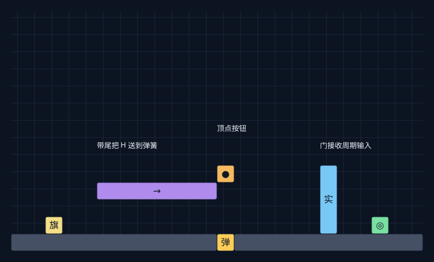

### 场景搭建

| 对象 | 左下角 | 宽高 | 配置 |
| --- | --- | --- | --- |
| Terrain | (0,0) | 12×1 | 笔刷默认 |
| Terrain | (13,0) | 11×1 | 笔刷默认 |
| Conveyor | (5,3) | 7×1 | {"Speed": 1.25} |
| Spring | (12,0) | 1×1 | {"Height": 3} |
| MechanismSwitch | (12,4) | 1×1 | 笔刷默认 |
| InversePhaseBlock | (18,1) | 1×4 | 笔刷默认 |
| Endpoint | (21,1) | 1×1 | 笔刷默认 |

### 一条探索路线

1. 从传送带左侧伸头再横移，把头留在向右带面上。

2. 头从带尾落到下方弹簧。身体留在按钮区之外，只观察。

3. 调整高处按钮高度，让头在顶点附近进入并退出；远处反相门每次进入时翻转。

### 输入与输出

| 输入或对照尝试 | 状态变化 | 可观察输出 |
| --- | --- | --- |
| H从上方落到SpringPad | 按弹簧Height=3计算向上速度 | H弹起，身体无需输入 |
| H每轮进入顶点按钮一次 | 一次新的占用边沿 | 全局P逐轮翻转 |
| 按钮放在弹跳中段 | 上升和下降可能是两次占用 | 一轮可能翻转两次，最终P不变 |
| 按钮高于可达最高点 | 没有任何实体进入 | 门保持原状态 |

### 思考点

- 弹簧把落下转换成上升，按钮把位移转换成全局状态；物体运动形成了事件源。

- 一个周期有几次输入，取决于路径与传感器位置，而不只取决于周期长度。

### 可以继续变形的方向

- 按钮放在顶点与中段形成对照，探索一轮一次和一轮两次翻转。

- 让身体在窗口内主动拾取或吸附头，终止周期输入，固定想要的P。

### 验证重点

- 这里使用SpringPad的3格配置；不是踩散落头产生的4.5格。

- 弹跳最高点应按弹簧真实碰撞顶部和头尺寸测量；带尾、弹簧落点和按钮感应区都要留空间余量。

## S16 低顶给头设定高度

**谜面：**保持空格经过高处按钮，但不能碰到它。怎样让头离开低顶以后也不继续长高？

伸头一旦被实体低顶阻挡，会进入Holding，离开阻挡物也不补足最大高度。低顶因此不是单纯障碍，还能设定这次悬停的头身距离。

**组合与起态：**伸头受阻 × 悬停 × 横移 × 按钮。画布 24×14，入口旗帜 (2, 1)，P=0，出生为合体。机制可组合，布局待实测。

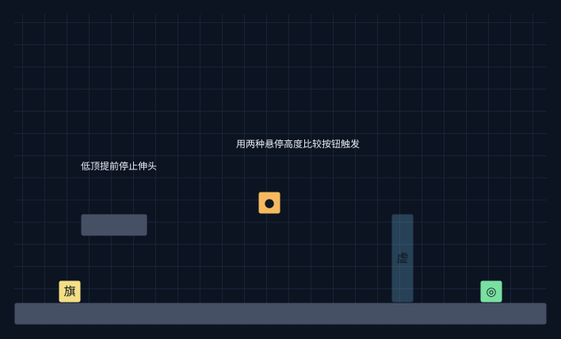

### 场景搭建

| 对象 | 左下角 | 宽高 | 配置 |
| --- | --- | --- | --- |
| Terrain | (0,0) | 24×1 | 笔刷默认 |
| Terrain | (3,4) | 3×1 | 笔刷默认 |
| MechanismSwitch | (11,5) | 1×1 | 笔刷默认 |
| PhaseBlock | (17,1) | 1×4 | 笔刷默认 |
| Endpoint | (21,1) | 1×1 | 笔刷默认 |

### 一条探索路线

1. 在低顶下方按住空格，等伸头撞顶停止并恢复左右移动。

2. 保持空格走出低顶，再经过右侧高处按钮。头仍保持受阻时的高度。

3. 与开阔地直接伸满再横移的分支比较：较高的头会进入高处按钮区并关上正相门。

### 输入与输出

| 输入或对照尝试 | 状态变化 | 可观察输出 |
| --- | --- | --- |
| 在低顶下伸头 | Extending→Holding，伸头提前停止 | 获得较低的悬停高度 |
| 保持空格走到开阔处 | 仍为Holding，不重启伸头 | 头不会补到最大高度 |
| 开阔处伸满再走同一路径 | 使用MaxExtension=3.4 | 更高的头可能触发按钮 |
| 松开后重新按空格 | 先收头合体，之后才可重新伸头 | 高度记忆属于这一次动作 |

### 思考点

- 环境可以给一次动作赋参数；玩家通过位置选择悬停高度。

- 障碍的作用取决于动作阶段，阻止上升可能反而保留一种有用形态。

### 可以继续变形的方向

- 提供两个低顶高度，令同一路径上的两个按钮只被其中一种头高度碰到。

- 把低顶换成反相块，让P选择本次可获得的悬停高度。

### 验证重点

- 伸头和收头时锁的是左右输入；传送带和重力仍能造成位移，不应当认为整个角色被完全冻结。

- 按钮的精确高度需使满伸头的碰撞区相交、短伸头不相交；草图保留高度对照而不强制完整解路。

## 进一步拼接

- 隔层遥控接先矮一次再长高：触发门以后继续保持分离，通路选择与形态选择连在一起。

- 换掉头脚下的地板接先下去才能跳得更高：一次虚化同时改变头的高度和吸附路径，再选择远距起点。

- 一颗头的两次脉冲接死亡是身体的回程：返回动画期间头仍在运输，完成一次异步机关任务。

- 只寄回头接同一颗头的三个答案：返回地址决定头的落点，接近方向决定取回、弹起或向下合体。

- 不要让按钮空出来接隔壁房间仍在计时：一个房间的接力占用决定另一个房间是否出现第二次翻转。

- 借头下楼接回溯分支：先观察一次多层穿透结果，再从同一刻改变接头的位置。

这些拼接先作为两张卡之间的状态接口：前卡输出的P、H位置、B位置、形态和复活点，必须满足后卡起态。不要直接把两个终点摆在一起就视为已完成组合。
